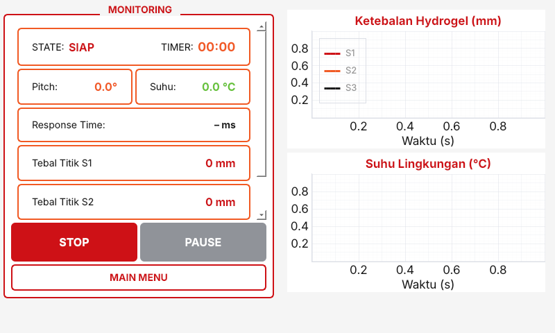
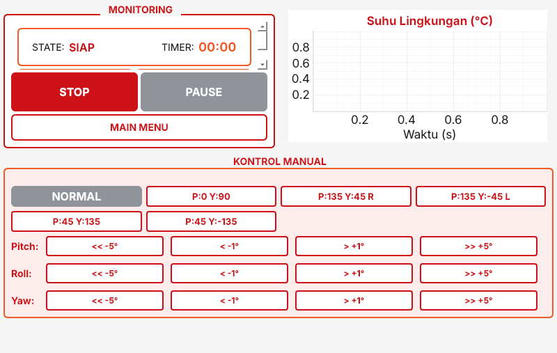
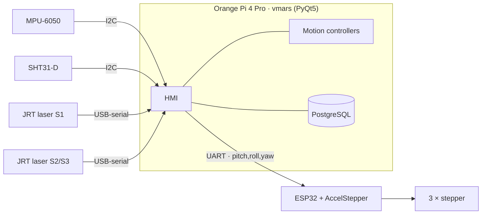

# V-MARS — Vascular Multi-Axis Rotation System

[](https://github.com/<your-username>/v-mars-hmi/actions/workflows/ci.yml)


Touchscreen HMI and closed-loop controller for **V-MARS**, a 3-axis (pitch · yaw ·
roll) rotation platform that fabricates **hydrogel artificial blood-vessel
models** in I, T, Y and 3D branch shapes.

Conventional dip-coating lets the fresh hydrogel sag under gravity, so the wall
ends up thicker at the bottom. V-MARS keeps the coated stick rotating, measures
the coating with laser sensors and then tilts the platform so the gel flows
towards whichever branch is thinnest — while supervising the drying
temperature and logging every run.

<p align="center">
  
  &nbsp;
  
</p>

> Final-year thesis project, Electrical Engineering, Institut Teknologi Bandung.

---

## Features

- **AUTO mode** — tumble → measure thickness at 3 points → pick a corrective pose
  for the thinnest branch → repeat every 60 s
  ([sequence](docs/process-sequence.md)).
- **MANUAL mode** — continuous tumbling with one-tap holding presets per shape
  and ±1°/±5° pitch, roll and yaw nudges.
- **Thickness feedback** from two JRT laser sensors (S2 runs in dual mode to give
  a third point), calibrated against the bare stick before coating.
- **Drying supervision** with an SHT31-D: warning below 24 °C, automatic abort
  below 20 °C.
- **Orientation feedback** from an MPU-6050, sampled only at the shape's crucial
  angles.
- **Run history** in PostgreSQL with search, sort and paging on the touchscreen.
- **Non-blocking by design** — every device and the database run on their own
  threads; the GUI thread never waits on I/O.

## Results (from the thesis evaluation)

| Metric | Result |
|--------|--------|
| Feedback response time | 172.22 ± 22.36 ms |
| Orientation deviation | ± 2.2° |
| Temperature sensor error | 0.07 °C (spec ± 1.0 °C) |
| Hydrogel thickness deviation | ± 1 mm |

## System architecture



More detail: [architecture](docs/architecture.md) ·
[serial protocol](docs/serial-protocol.md) ·
[hardware setup](docs/hardware-setup.md) ·
[database](docs/database.md)

## Repository layout

```
v-mars-hmi/
├── vmars/
│   ├── config.py          all tunable parameters (+ .env loading)
│   ├── control/           pure process logic — no Qt, no hardware, fully tested
│   ├── hardware/          ESP32, MPU-6050, SHT31-D and JRT laser drivers
│   ├── storage/           PostgreSQL history (background worker)
│   ├── ui/                PyQt5 screens, dialogs and widgets
│   └── assets/            logo and stick pictures
├── tests/                 pytest suite (logic + off-screen GUI smoke test)
├── docs/                  architecture, sequence, protocol, hardware, database
├── firmware/              ESP32 motor firmware
└── deploy/                udev rules and autostart entry for the Orange Pi
```

## Installation (Orange Pi)

```bash
# 1. System packages (installing PyQt5 through pip on ARM is slow and unreliable)
sudo apt update
sudo apt install python3-pyqt5 python3-pyqtgraph python3-serial \
                 python3-psycopg2 python3-smbus python3-venv postgresql i2c-tools

# 2. Code
git clone https://github.com/<your-username>/v-mars-hmi.git
cd v-mars-hmi
python3 -m venv --system-site-packages .venv
.venv/bin/pip install -e . --no-deps
# (if python3-pyqtgraph is not packaged for your image: .venv/bin/pip install pyqtgraph)

# 3. Configuration
cp .env.example .env        # set the database password and serial ports
sudo -u postgres createdb rotation_platform

# 4. Pictures: copy the logo and I/T/Y/3D images into vmars/assets/
```

Then enable I2C and the ESP32 UART and give your user access to the devices —
see [hardware setup](docs/hardware-setup.md).

## Running

```bash
.venv/bin/python -m vmars              # full screen (kiosk)
.venv/bin/python -m vmars --windowed   # 1024×600 window
.venv/bin/python -m vmars --debug      # verbose logging
```

**F11** toggles full screen, **Esc** leaves full screen (and closes the app
when windowed). The HMI also starts on a laptop without any hardware attached:
missing devices are logged and skipped.

### Operating flow

1. **MENU INPUT PARAMETER** → choose the stick shape (I / T / Y / 3D), the mode,
   branch dimensions, target thickness and run time.
2. **START PROCESS**
   - *AUTO*: the lasers first measure the **bare stick** (baseline). Coat the
     stick with gel, confirm, and the sequence starts.
   - *MANUAL*: starts tumbling immediately; use the preset buttons to hold a pose.
3. Watch state, countdown, pitch, temperature and thickness on
   **MENU DATA MONITORING**. **PAUSE** freezes the sequence, **STOP** ends it.
4. Every run is stored and browsable in **MENU DATABASE**.

## Configuration

Deployment settings come from environment variables (or `.env`):

| Variable | Default |
|----------|---------|
| `VMARS_DB_NAME` / `_USER` / `_PASSWORD` / `_HOST` / `_PORT` | `rotation_platform` / `postgres` / *(empty)* / `localhost` / `5432` |
| `VMARS_ESP32_PORT` | `/dev/ttyS2` |
| `VMARS_JRT_S1_PORT` | `/dev/ttyUSB0` |
| `VMARS_JRT_S2_PORT` | `/dev/ttyUSB1` |

Process parameters (timings, speeds, thresholds, steps per revolution, IMU
offset) are named constants in [`vmars/config.py`](vmars/config.py); correction
poses and manual presets are tables in
[`vmars/control/sequences.py`](vmars/control/sequences.py).

## Development

```bash
pip install -r requirements-dev.txt
pytest -q          # logic tests + off-screen GUI smoke test
ruff check .
```

The motion controllers are plain Python objects that take a timestamp and
return a motor command, so the complete AUTO/MANUAL sequence can be simulated
in tests without hardware or a display. See
[REFACTORING_NOTES](docs/REFACTORING_NOTES.md) for how the current code was
verified against the original lab version.

## Author

**Bramantio Ananda** — HMI, feedback control, temperature measurement and
drying management · [portfolio](https://bramantio-ananda-portfolio.netlify.app/)

Developed with the V-MARS thesis team, Electrical Engineering, Institut
Teknologi Bandung.

## License

No license has been chosen yet — all rights reserved by the authors until a
`LICENSE` file is added.
