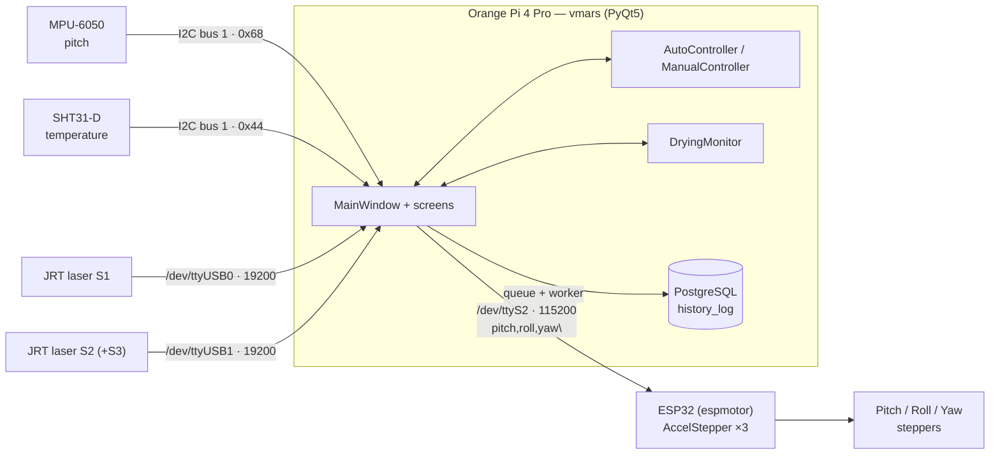
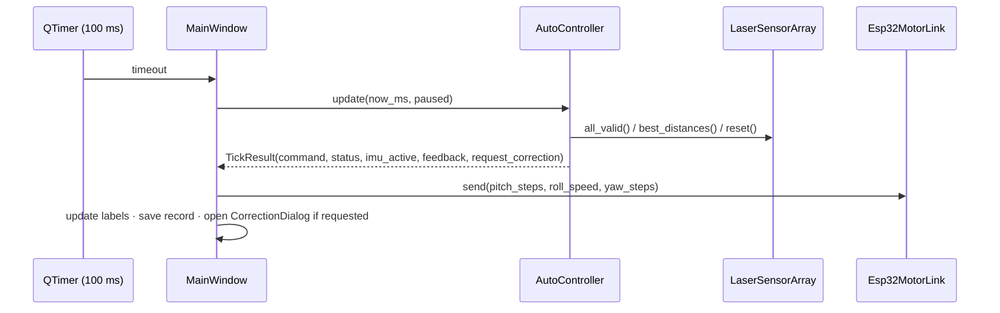

# Architecture

## System overview



## Layers

```
vmars/
├── config.py          every tunable number + .env loading
├── control/           PURE logic — no Qt, no serial, no I2C
│   ├── motion.py          shared types (MotionCommand, TickResult, offsets)
│   ├── auto_controller.py AUTO sequence (tumble → measure → correct)
│   ├── manual_controller.py MANUAL sequence (tumble + preset holds)
│   ├── sequences.py       correction profiles & manual presets as DATA
│   ├── feedback.py        thickness + "which branch is thinnest" rules
│   ├── roll.py            roll dead-reckoning (finish full revolutions)
│   └── drying.py          temperature state machine
├── hardware/          device drivers (each owns its background thread)
│   ├── protocol.py        wire formats (pure, unit-tested)
│   ├── esp32.py, imu.py, temperature.py, laser.py, i2c.py
├── storage/database.py   PostgreSQL log on a worker thread
└── ui/                PyQt5 only — no process decisions
    ├── main_window.py     wiring + timers
    ├── screens/           menu, input, monitor, database
    ├── dialogs.py, widgets.py, style.py
```

Dependency direction is one-way: `ui → control, hardware, storage` and
`control → config`. Nothing in `control/` imports Qt, so the full motion
sequence can be simulated in tests at thousands of ticks per second.

## Threads

| Thread            | Owner                     | Job                                          |
|-------------------|---------------------------|----------------------------------------------|
| Qt main thread    | `MainWindow`              | GUI, 100 ms control tick, 1 s UI tick        |
| `esp32-tx`        | `Esp32MotorLink`          | writes queued commands to the ESP32          |
| `esp32-rx`        | `Esp32MotorLink`          | drains ESP32 debug output                    |
| `imu`             | `Mpu6050Imu`              | polls pitch every 50 ms (only when active)   |
| `sht31`           | `Sht31TemperatureSensor`  | polls temperature every 500 ms               |
| `jrt-S1`, `jrt-S2`| `LaserSensorWorker`       | single shot every 10 s, keeps best reading   |
| `db-worker`       | `HistoryRepository`       | INSERT / SELECT, results back via Qt signal  |

The GUI thread never performs blocking I/O. Shared values are guarded by
locks inside each driver; the controllers only read them through small,
thread-safe getters.

## One control tick (100 ms)


