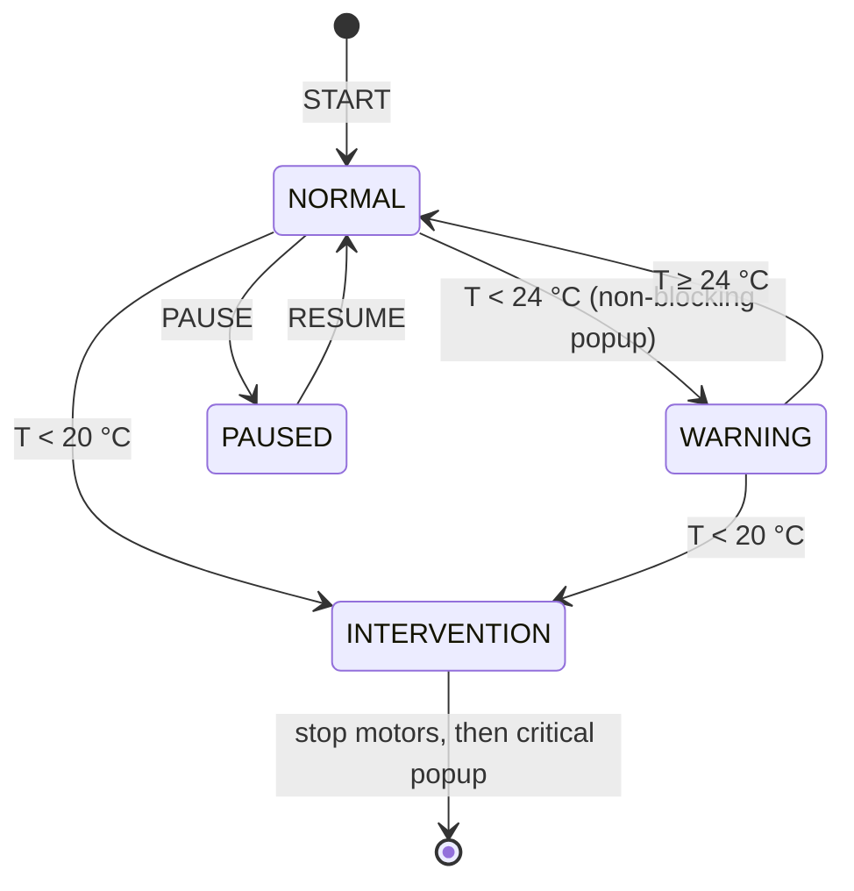

# Process sequence

All numbers below come from `vmars/config.py` and `vmars/control/sequences.py`.

## Why the platform rotates

A freshly coated hydrogel layer sags under gravity (the classic dip-coating
problem). V-MARS keeps the coated stick moving on three axes — **pitch**,
**yaw** and **roll** — so gravity never acts in one direction long enough to
create a drip. When the lasers find a branch that is thinner than the others,
the platform holds a pose that lets the gel flow *towards* that branch.

## AUTO mode

```
t (s)   0 ─────────────── 32 ──────── 40 ─┬─ 41 ───── 45 ─┬──────────── 100 ─┬─ …
        AWAL                STABIL         │ UKUR           │ correction       │ next cycle
        pitch & yaw 22.5°/s  roll+yaw stop │ lasers measure │ profile          │
        roll 600 steps/s     pitch → 900°  │ (window 1–5 s) │ (see table)      │
```

| Phase   | Pitch                         | Yaw                       | Roll            |
|---------|-------------------------------|---------------------------|-----------------|
| AWAL    | 22.5°/s · t                   | 22.5°/s · t (I-shape: 0)  | 600 steps/s     |
| STABIL  | 22.5°/s · t → 900° at 40 s    | 720° (I-shape: 0)         | stop*           |
| UKUR    | base = 900° + 360°·cycle (≡ 180°) | base                  | stop*           |

\* "stop" always finishes the current roll revolution first
(`RollPositionTracker`), so the stick faces the lasers the same way every cycle.
The laser **measurement window** opens 1 s into UKUR and only once the roll has
finished its revolution.

### Measurement outcome

* **All sensors valid before 5 s** → UKUR ends early.
* **Not valid at 5 s** → the clock freezes and the *Koreksi Manual* dialog
  opens. The operator nudges pitch/roll/yaw; the dialog closes by itself once
  the readings are valid.
* **A connected sensor reads 0 mm thickness** (same as the bare stick) → the
  readings are cleared and UKUR is repeated.
* **Valid** → thickness = baseline − distance, the shape rule below picks a
  correction profile, and the result is logged to the database.

### Decision rules (`control/feedback.py`)

| Shape | Condition | Meaning |
|-------|-----------|---------|
| I  | `I-A` | S1 ≤ S2 → stay at 180° |
| I  | `I-B` | S2 thinner → go to 0° |
| Y  | `Y-C` | S1 thinnest → pitch 0°, yaw +90° |
| Y  | `Y-D-S2/S3` | S2/S3 thinnest and S1 thickest → pitch 135°, yaw ±45°, roll ± |
| Y  | `Y-E-S2/S3` | S2/S3 thinnest, the other thickest → pitch 45°, yaw ±135° |
| T  | `T-A-S2/S3` | S1 thinnest (S2/S3 thickest) → pitch 45°, yaw ±135°, roll ± |
| T  | `T-B-S2/S3` | S2/S3 thinnest → pitch 135°, yaw ±45°, roll ± |
| 3D | `3D-A` | S1 thinnest → pitch 0° |
| 3D | `3D-B/C` | S2/S3 thinnest → pitch 90°, yaw ±90°, roll ± |

### Correction profiles (`control/sequences.py`)

Times are seconds into the 60 s cycle. After `hold until` every profile does
"+360° pitch, yaw back to base, roll 600" (`LANJUT`).

| Code | Pitch offset (physical) | Yaw offset | Travel until | Hold until | Roll while holding |
|------|------------------------|-----------:|-------------:|-----------:|-------------------:|
| I-A      | 0° (180°)   | 0     | —  | 39 | 0 |
| I-B      | +180° (0°)  | 0     | 13 | 47 | 0 |
| Y-C      | +180° (0°)  | +90   | 13 | 47 | 0 |
| Y-D-S2/3 | +315° (135°)| ±45   | 19 | 53 | ±150 |
| Y-E-S2/3 | +225° (45°) | ±135  | 15 | 49 | 0 |
| T-A-S2/3 | +225° (45°) | ±135  | 15 | 49 | ±150 |
| T-B-S2/3 | +315° (135°)| ±45   | 19 | 53 | ±150 |
| 3D-A     | +180° (0°)  | 0     | 13 | 47 | 0 |
| 3D-B/C   | +270° (90°) | ±90   | 17 | 51 | ±150 |

Adding a new shape or tweaking a timing is a one-line change in that table.

## MANUAL mode

The platform tumbles continuously (pitch 45°/s, yaw 45°/s except I-shape,
8 s cycle). The operator chooses a preset; the controller waits for the
preset's moment in the cycle, then **holds** that pitch/yaw for 30 s (with the
preset roll speed) and resumes tumbling. Pitch/roll/yaw nudge buttons are
enabled only while holding. Laser sensors are off in this mode.

| Shape | Presets |
|-------|---------|
| I  | GO 0° · STAY 180° |
| Y  | P:0 Y:90 · P:135 Y:±45 (R/L) · P:45 Y:±135 |
| T  | P:45 Y:±135 (R/L) · P:135 Y:±45 (R/L) |
| 3D | P:0 Y:0 · P:90 Y:±90 (R/L) |

## Drying supervision (both modes)



## IMU sampling

The MPU-6050 is only polled when the pitch target is near one of the shape's
crucial angles (I: 0/180 · T: 45/135/180 · Y: 0/45/135/180 · 3D: 0/90/180/270).
AUTO additionally requires the pose to have been stable for 1–3 s.
